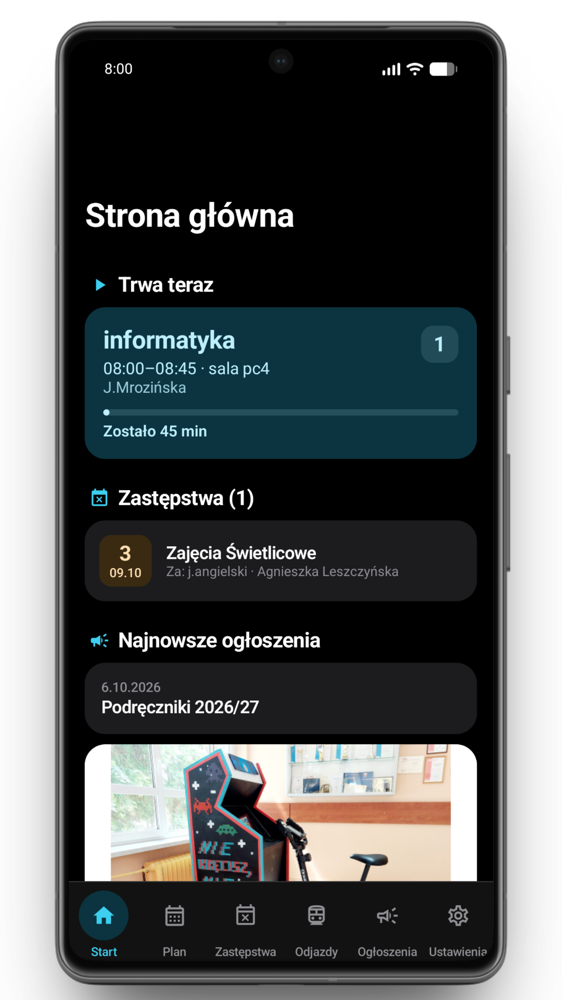
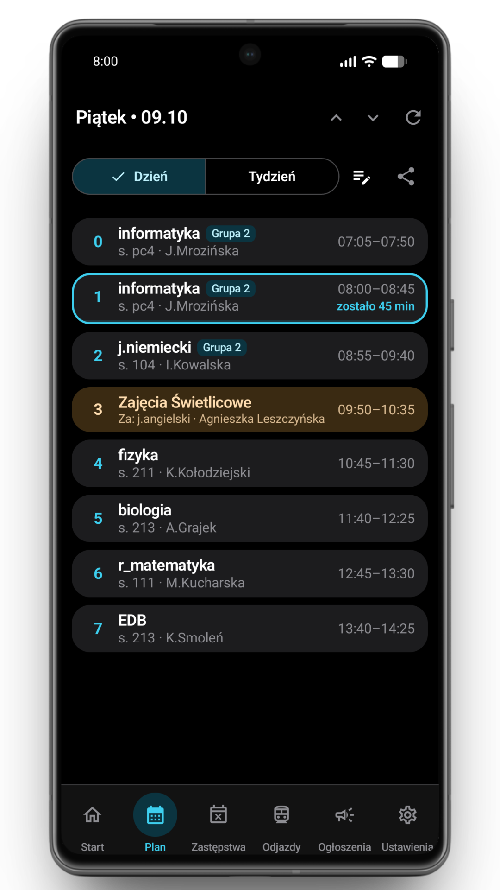
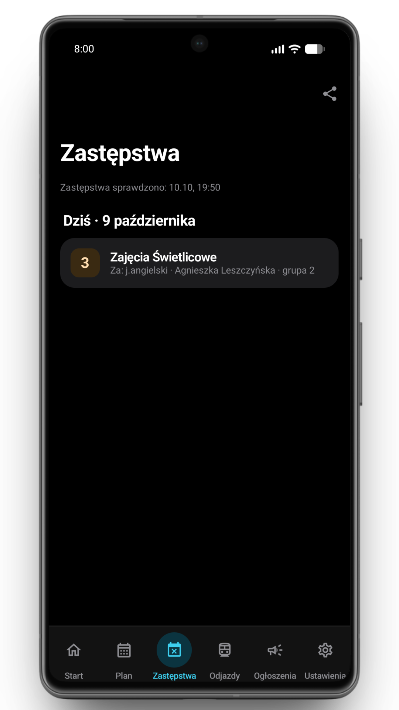
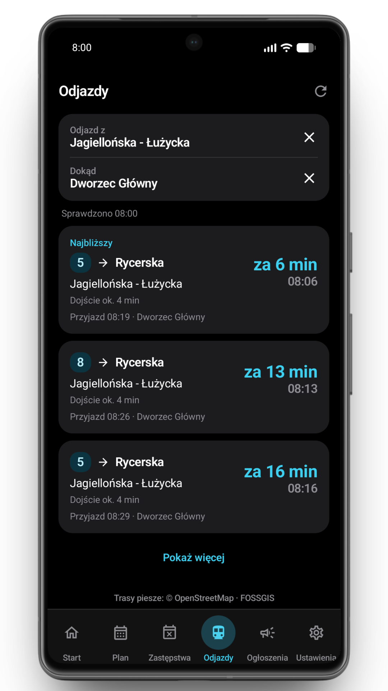
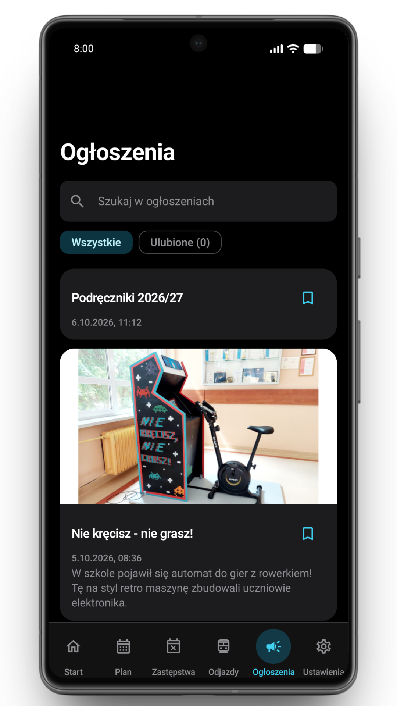
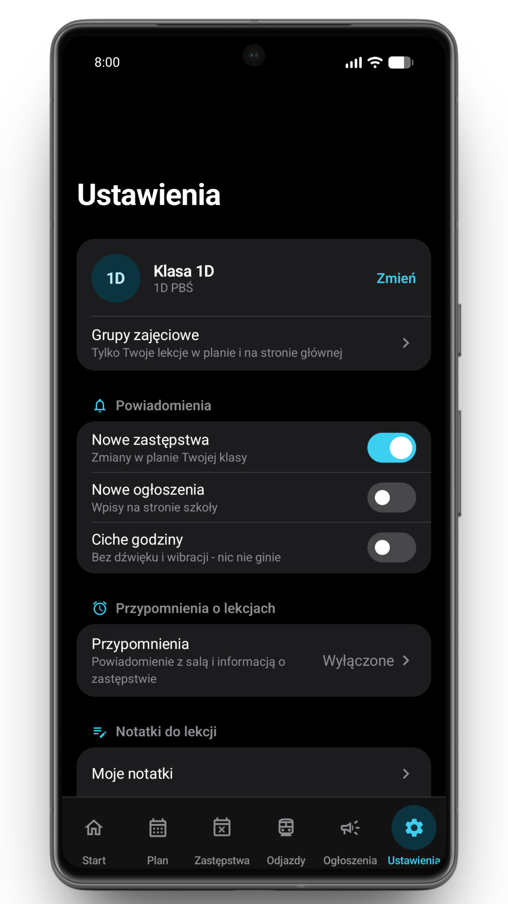
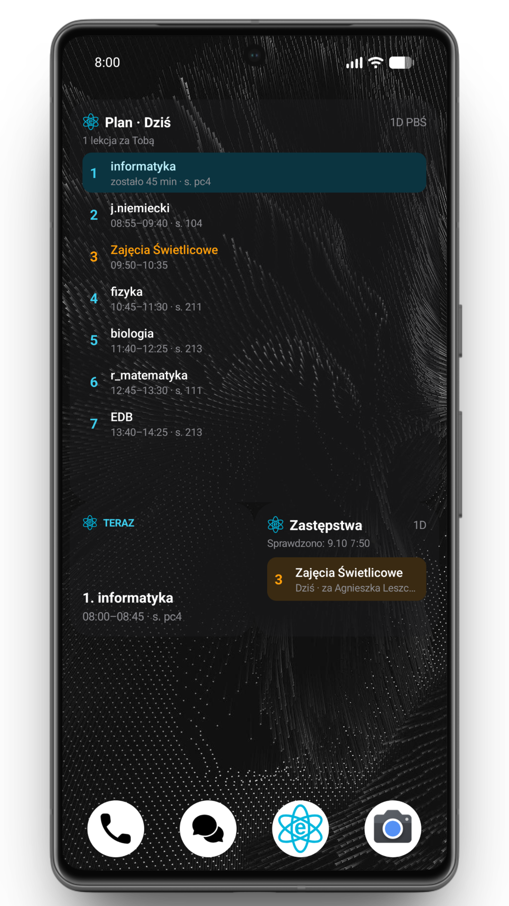
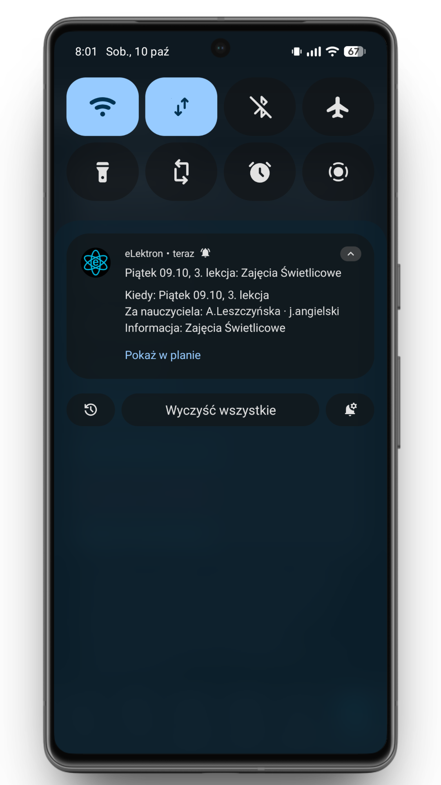

<div align="center">


# Elektron-Vulcan

**Nowoczesna, otwartoźródłowa aplikacja na Androida dla uczniów ZSE w Bydgoszczy – plan lekcji, zastępstwa, ogłoszenia szkolne, oceny i terminarz z konta eduVULCAN, Symulator Ocen, Strażnik Frekwencji oraz powiadomienia na żywo „Kiedy dzwonek?”.**

[](https://github.com/Klap3K/Elektronv2/actions/workflows/ci.yml)
[](https://github.com/Klap3K/Elektronv2/releases/tag/v2.1.1)
[](https://github.com/Klap3K/Elektronv2/releases/download/v2.1.1/Elektron-Vulcan.apk)
[](LICENSE)

-3DDC84?logo=android&logoColor=white)


[**🚀 Pobierz najnowszą wersję (v2.1.1 APK)**](https://github.com/Klap3K/Elektronv2/releases/download/v2.1.1/Elektron-Vulcan.apk) • [**📦 Wydanie v2.1.1**](https://github.com/Klap3K/Elektronv2/releases/tag/v2.1.1) • [**Wszystkie wydania**](https://github.com/Klap3K/Elektronv2/releases) • [**Poradnik eduVULCAN**](PORADNIK_VULCAN.md) • [**Polityka Prywatności**](PRYWATNOSC.md) • [**Bezpieczeństwo**](SECURITY.md) • [**Zgłoś błąd / Sugestie**](https://github.com/Klap3K/Elektronv2/issues/new)

</div>

---

## 📥 Pobieranie najnowszej wersji (v2.1.1)

Oficjalny, podpisany instalator APK dla Androida (wersja **2.1.1**, kod **48**):

<p align="center">
  <a href="https://github.com/Klap3K/Elektronv2/releases/download/v2.1.1/Elektron-Vulcan.apk">
    
  </a>
</p>

- 🚀 **[Bezpośrednie pobranie Elektron-Vulcan.apk (v2.1.1)](https://github.com/Klap3K/Elektronv2/releases/download/v2.1.1/Elektron-Vulcan.apk)** — instalacja wprost na telefonie (instaluje się jako aktualizacja na poprzednią wersję bez utraty danych).
- 📋 **[Notatki i opis wydania v2.1.1 na GitHubie](https://github.com/Klap3K/Elektronv2/releases/tag/v2.1.1)**.
- 📦 **[Wszystkie dotychczasowe wydania aplikacji (GitHub Releases)](https://github.com/Klap3K/Elektronv2/releases)**.

---

## 📖 O projekcie Elektron-Vulcan

**Elektron-Vulcan** to kompletne, w pełni otwartoźródłowe środowisko mobilne dla społeczności Zespołu Szkół Elektronicznych w Bydgoszczy. Aplikacja eliminuje konieczność ciągłego sprawdzania wielu stron i systemów: łączy szkolny plan lekcji, zmiany sal i zastępstwa, oficjalne ogłoszenia oraz odjazdy komunikacji miejskiej ZDMiKP z **bezpośrednią integracją z kontem eduVULCAN** (oceny cząstkowe, sprawdziany, kartkówki, prace domowe i frekwencja).

Wszystkie dane przechowywane są lokalnie na telefonie (architektura **Offline-First**), a newralgiczne informacje sesyjne podlegają szyfrowaniu sprzętowemu w module **Android Keystore (AES-GCM)**.

---

## ✨ Główne Funkcje

### 🎓 Dziennik eduVULCAN, Terminarz i Oceny
- **Bezpośrednie logowanie do konta eduVULCAN (`eduvulcan.pl`):** bezpieczna autoryzacja bez pośredników, obsługa domen miejskich i portali samorządowych (`bcu.gov.pl`), automatyczny wybór profilu ucznia.
- **Pełna synchronizacja danych:** pobieranie ocen cząstkowych z wagami, sprawdzianów, prac klasowych, kartkówek, prac domowych oraz statystyk obecności.
- **Zintegrowany terminarz:** sprawdziany i kartkówki są automatycznie dopasowywane do konkretnych godzin lekcji w widoku dnia, w siatce tygodnia oraz na widżetach.
- **Alternatywne źródła:** wbudowany mostek powiadomień z aplikacji eduVULCAN oraz obsługa subskrypcji kalendarza iCal (`.ics` / `webcal://`).
- *Szczegółowy przewodnik:* [**PORADNIK_VULCAN.md**](PORADNIK_VULCAN.md).

### 🔮 Symulator Ocen „Co jeśli” (Grade Simulator)
- **Natychmiastowa symulacja:** sprawdzaj wpływ przewidywanych ocen na średnią ważoną danego przedmiotu oraz ogólną średnią ocen ucznia.
- **Wirtualne oceny cząstkowe:** szybkie dodawanie ocen jednym dotknięciem (`+6`, `+5`, `+4`, `+3`, `+2`, `+1`) z możliwością wyboru wagi (1–4).
- **Interaktywny podgląd na żywo:** dynamiczne porównanie średnich (np. `Śr: 3.40 ➔ 3.65`), wyróżnione etykiety symulowanych ocen oraz możliwość cofnięcia lub zresetowania symulacji jednym kliknięciem.

### 🛡️ Strażnik Frekwencji & Kalkulator Bilansu (`AttendanceBalance`)
- **Konfigurowalny próg docelowy:** ustawienie własnego, bezpiecznego celu obecności (od 50% do 95%, domyślnie rekomendowane 75%) w Ustawieniach i bezpośrednio w oknie Strażnika (szybkie kafelki).
- **Dwupoziomowa ochrona matematyczna:**
  - **Bezpieczny cel ucznia:** wylicza bezpieczny zapas godzin do opuszczenia przed spadkiem poniżej celu (`maxMissableToTarget`) lub liczbę godzin obecności z rzędu potrzebnych do jego odrobienia (`recoveryNeededToTarget`).
  - **Ustawowy próg krytyczny (50%):** równoległe monitorowanie dystansu od zagrożenia nieklasyfikowaniem (`maxMissableTo50` i `recoveryNeededTo50`).
- **Widoczność na pulpicie i przedmiotach:** wskaźnik bilansu godzin bezpośrednio na karcie głównej Dashboardu oraz przy każdym przedmiocie (oznaczenia kolorystyczne: zielony, pomarańczowy, czerwony).
- **Interaktywny symulator opuszczeń:** symulacja opuszczenia kolejnych godzin (`+1h`, `+2h`, `+4h`, `+8h`) z pełnym przewijaniem horyzontalnym.

### 🔔 Ciągłe Powiadomienie na żywo „Kiedy dzwonek?” (Live Bell)
- **Status na ekranie blokady i AOD:** licznik czasu do najbliższego dzwonka na żywo, sala lekcyjna, nazwa trwającej lekcji oraz graficzny pasek postępu.
- **Informacja o dyżurze:** wskaźnik obowiązków dyżurnego klasowego wprost w powiadomieniu.
- **Optymalizacja energetyczna:** precyzyjny harmonogram alarmów bez drenowania baterii telefonu.

### 🔔 Powiadomienia różnicowe Smart Diff
- **Wykrywanie nowych ocen w tle:** okresowa synchronizacja przez `WorkManager` wykrywa nowe oceny wpisane przez nauczycieli i wysyła powiadomienia systemowe bez generowania fałszywego spamu.

### 🔕 Auto DND – Automatyczne wyciszanie na lekcjach
- **Inteligentne wyciszanie:** automatyczne włączanie trybu Nie Przeszkadzać (DND) wyłącznie podczas trwania realnych lekcji.
- **Przywracanie dźwięku:** natychmiastowe przywracanie wyjściowego profilu dźwiękowego (normalny, wibracje, cichy) na dzwonek oznaczający przerwę, w okienkach oraz po zakończeniu zajęć.
- **Niezawodność w tle:** obsługa przez `AlarmManager.setExactAndAllowWhileIdle` przy zablokowanym telefonie.

### ⏳ Odliczanie do wydarzeń (Countdown)
- Dynamiczne odliczanie do wakacji, ferii zimowych, 100-dniówki, egzaminów zawodowych lub dowolnej własnej daty z kalendarza Material 3.
- Niezależny licznik **dni szkolnych (poniedziałek–piątek)** oraz licznik dni kalendarzowych z poprawną polską odmianą.

### 🧹 Karta Dyżurnego Klasowego
- Informacja na pulpicie o nadchodzącym dyżurze (dzisiaj, w tym tygodniu, za X dni).
- Automatyczna rotacja par uczniów według numerka w dzienniku oraz zintegrowana lista obowiązków.

### 🎨 Personalizacja Pulpitu & Nowy Układ Ustawień
- **Konfiguracja strony głównej:** możliwość włączania, wyłączania oraz zmiany kolejności kart pulpitu pod własne preferencje.
- **4 przejrzyste kategorie Ustawień:** *Twoja Klasa i Dziennik*, *Dzwonki, Lekcje i Powiadomienia*, *Wygląd i Układ*, *Aplikacja i System*.

### 📅 Plan lekcji, Zastępstwa i Ogłoszenia
- Pełna siatka planu lekcji zintegrowana z zastępstwami, podziałem na grupy (języki, informatyka, WF) oraz salami zastępczymi.
- Ogłoszenia ze strony `zse.bydgoszcz.pl` z trybem offline i zapisywaniem artykułów do ulubionych.
- Rozkłady odjazdów ZDMiKP Bydgoszcz z przystanków wokół szkoły z czasem dojścia pieszego.

### 📱 Widżety Glance na Pulpit
- Nowoczesne widżety Jetpack Glance: *Następna lekcja*, *Plan dnia* oraz *Zastępstwa* z etykietami sprawdzianów.

### ⚡ Wbudowane aktualizacje 1 kliknięciem
- Automatyczne powiadomienie o nowym wydaniu przy starcie aplikacji, pobieranie APK wewnątrz aplikacji i natychmiastowe uruchomienie instalatora Androida bez utraty danych.

---

## 📱 Zrzuty ekranu

<div align="center">

| Strona główna | Plan lekcji | Zastępstwa | Odjazdy ZDMiKP |
|:---:|:---:|:---:|:---:|
|  |  |  |  |

| Ogłoszenia szkolne | Ustawienia | Widżety Glance | Powiadomienia |
|:---:|:---:|:---:|:---:|
|  |  |  |  |

</div>

---

## 🛠️ Architektura i Stos Technologiczny

Projekt zrealizowany jest zgodnie z wytycznymi nowoczesnego developmentu Androida (**Modern Android Development - MAD**), Clean Architecture oraz wzorcem MVI/MVVM:

| Warstwa / Komponent | Zastosowana Technologia |
|:---|:---|
| **Język programowania** | Kotlin 2.0.20 (Coroutines 1.8.1, StateFlow, Flow) |
| **Interfejs użytkownika** | Jetpack Compose (BOM 2024.09.02), Material Design 3, Dynamic Color |
| **Wstrzykiwanie zależności** | Dagger Hilt 2.52 (`@HiltViewModel`, Hilt Work) |
| **Baza danych** | AndroidX Room 2.6.1 (Schemat v6 z atomowymi migracjami) |
| **Pamięć klucz-wartość** | Jetpack DataStore Preferences 1.1.1 |
| **Zadania w tle i powiadomienia** | WorkManager 2.9.1, AlarmManager, Foreground Service |
| **Widżety pulpitu** | AndroidX Glance 1.1.0 |
| **Sieć i parsowanie** | OkHttp 4.12.0, Jsoup 1.18.1, AndroidX WebKit 1.11.0 |
| **Ładowanie obrazów** | Coil Compose 2.7.0 |
| **Testy jednostkowe i UI** | JUnit 4, Robolectric 4.13, Coroutines Test, Compose UI Test |
| **Optymalizacja i minifikacja** | R8 / ProGuard (zoptymalizowane reguły pod Compose i DTO) |

---

## 🔒 Bezpieczeństwo i Android Keystore

Bezpieczeństwo danych użytkownika jest priorytetem projektu:
1. **Szyfrowanie sprzętowe Android Keystore:** Wrażliwe dane autoryzacyjne konta eduVULCAN (ciasteczka sesyjne, tokeny) są szyfrowane algorytmem **AES-GCM-256** przy użyciu kluczy generowanych i chronionych sprzętowo przez **Android Keystore**. Żadne hasła ani tokeny nie są zapisywane jawnym tekstem.
2. **Brak serwerów pośredniczących:** Połączenie z dziennikiem eduVULCAN realizowane jest wyłącznie bezpośrednio pomiędzy urządzeniem użytkownika a domenami VULCAN (`eduvulcan.pl`, `uczen.eduvulcan.pl`, `bcu.gov.pl`). Twórcy aplikacji nie posiadają serwerów proxy i nie mają wglądu w dane użytkowników.
3. **Wykluczenie z Google Cloud Backup:** Baza danych z ocenami i frekwencją oraz magazyn poświadczeń są wykluczone z systemowej kopii zapasowej w chmurze (`android:allowBackup="false"` dla wrażliwych reguł).
4. **Izolacja WebView:** Komponenty webowe używane podczas logowania podlegają ścisłym regułom bezpieczeństwa, blokadzie obcych domen i czyszczeniu pamięci po zakończeniu sesji.
5. **Czysta polityka prywatności:** Zero trackerów, zero zewnętrznej analityki, zero reklam.

Szczegółowe wytyczne dotyczące bezpieczeństwa i zgłaszania podatności znajdują się w pliku [**SECURITY.md**](SECURITY.md).

---

## 📦 Warianty kompilacji (Build Variants)

Aplikacja wspiera dwa warianty dystrybucyjne (`productFlavors`):

| Wariant | Zastosowanie | Usługi Google / Firebase | Auto-Update |
|:---:|:---|:---:|:---:|
| **`github`** *(Domyślny)* | Oficjalne wydania instalacyjne APK publikowane na GitHub Releases. | ❌ Całkowity brak zależności od Google Services / Firebase. | ✅ Wbudowany sprawdzacz aktualizacji i natychmiastowy instalator APK. |
| **`gms`** | Wariant opcjonalny dla urządzeń z Google Play Services. | ✅ Integracja z Firebase Cloud Messaging (FCM) dla powiadomień push. | ✅ Sprawdzanie wydań GitHub Releases. |

*Uwaga:* Oba warianty posiadają ten sam `applicationId` (`pl.zse.bydgoszcz.elektron.vulcan`), co umożliwia płynną migrację pod warunkiem zachowania spójności klucza podpisu.

---

## 🚀 Instrukcja kompilacji i uruchomienia (Getting Started)

### Wymagania wstępne
- **JDK:** Wersja 17 lub nowsza (rekomendowany JDK 21 Temurin).
- **Android SDK:** `compileSdk = 35`, `targetSdk = 35`, `minSdk = 26` (Android 8.0 Oreo+).
- **Android Studio:** Ladybug / Meerkat lub nowsze z obsługą Kotlin 2.0+.

### Klonowanie repozytorium
```sh
git clone https://github.com/Klap3K/Elektronv2.git
cd Elektronv2
```

### Kompilacja i budowanie paczek APK

1. **Budowanie wariantu domyślnego (`github`):**
   ```sh
   # Wersja Debug (do testów na podłączonym telefonie / emulatorze)
   ./gradlew :app:assembleGithubDebug

   # Wersja Release (podpisana kluczem lub niepodpisana przy braku keystore.properties)
   ./gradlew :app:assembleGithubRelease
   ```

2. **Budowanie wariantu z Google Services (`gms`):**
   ```sh
   # Bez lokalnego pliku google-services.json (tryb CI)
   ./gradlew -Pelektron.gms=false :app:assembleGmsRelease

   # Z własną konfiguracją Firebase (patrz PORADNIK_PUSH.md)
   ./gradlew :app:assembleGmsRelease
   ```

3. **Uruchamianie testów jednostkowych i weryfikacja kodu:**
   ```sh
   # Testy jednostkowe (Robolectric + JUnit)
   ./gradlew :app:testGithubDebugUnitTest :app:testGmsDebugUnitTest

   # Analiza statyczna kodu (Android Lint)
   ./gradlew :app:lintGithubRelease
   ```

### Konfiguracja podpisu wydań produkcyjnych
Dla lokalnego budowania wydań produkcyjnych skopiuj plik szablonu:
```sh
cp keystore.properties.example keystore.properties
```
i uzupełnij go ścieżką do swojego pliku `.jks` oraz hasłami (plik `keystore.properties` jest chroniony przez `.gitignore`).

W środowisku **GitHub Actions CI/CD** proces podpisywania konfiguruje się w środowisku `release` za pomocą sekretów:
- `RELEASE_KEYSTORE_BASE64`: Magazyn kluczy zakodowany w Base64.
- `RELEASE_STORE_PASSWORD`: Hasło magazynu kluczy.
- `RELEASE_KEY_ALIAS`: Alias klucza podpisu.
- `RELEASE_KEY_PASSWORD`: Hasło klucza podpisu.

---

## ⚖️ Licencja i Nota Prawna

Projekt udostępniany jest na warunkach otwartoźródłowej licencji **GNU General Public License v3.0 lub nowszej** ([GPL-3.0-or-later](LICENSE)).

### ⚠️ Zastrzeżenie prawne (Legal Disclaimer)
*Aplikacja **Elektron-Vulcan** jest niezależnym, otwartoźródłowym projektem stworzonym pro bono przez społeczność uczniów na rzecz Zespołu Szkół Elektronicznych w Bydgoszczy. Aplikacja **nie jest** w żaden sposób powiązana, autoryzowana, sponsorowana ani wspierana przez firmę **VULCAN sp. z o.o.** Nazwy „VULCAN”, „eduVULCAN” oraz znaki towarowe i logo są wyłączną własnością ich prawnych właścicieli i zostały użyte wyłącznie w celach identyfikacyjnych i informacyjnych.*
